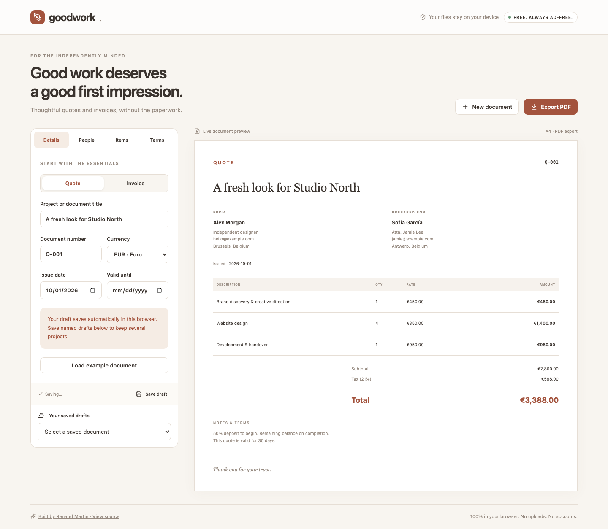

# Goodwork

Considered quotes and invoices for independent work.

[Live app](https://rjamartin.github.io/quote-builder/) · [Design & engineering case study](docs/CASE_STUDY.md)



## Features

- Quote and invoice modes
- Editable sender, client, project and line items
- EUR, USD and GBP formatting
- Discounts and tax with cent-based total calculations
- Live document preview and downloadable, multipage A4 PDFs
- Automatic current-draft storage and up to 30 saved drafts on the same device

## Run locally

Node.js 22.12 or newer is required.

```sh
npm ci
npm run dev
```

```sh
npm test
npm run build
npm run preview
```

`npm run format` formats source and documentation. No API keys, database, backend or environment variables are needed.

## Deployment

This repository has a **Deploy to GitHub Pages** workflow. In repository **Settings → Pages**, select **GitHub Actions** as the source. In **Actions → Deploy to GitHub Pages**, choose **Run workflow** on `main`. The action installs the locked dependencies, tests and builds the app, then publishes `dist/`.

Publishing is manual so pushing work in progress does not immediately change the live portfolio. The relative Vite base supports both `/quote-builder/` and a custom-domain root. A separate CI workflow runs tests and a production build on pushes and pull requests.

## Architecture

- `src/App.tsx`: application state and interactive UI
- `src/document.ts`: processing and export logic
- `src/ui.tsx`: UI helpers and downloads
- `src/styles.css`: responsive visual system
- `src/*.test.ts`: focused behavior tests

TypeScript handles browser APIs and file-processing boundaries. React handles the interactive workspace; Vite emits ordinary static files suitable for GitHub Pages.

## Privacy

All processing runs on the visitor's device. File contents are never uploaded. There are no analytics or third-party runtime requests. Hosting still receives ordinary page and asset requests.

## Limits

- Drafts are local to the browser and can be lost if site data is cleared. There is no account sync.
- 100 line items; contact blocks support up to 10 lines each.
- The bundled PDF font supports Latin text; unsupported characters produce a clear export error.
- This is a document builder, not accounting software or jurisdiction-specific e-invoicing. Add the business identifiers and terms required for your use.
- The HTML preview is a live content preview; the downloaded PDF is paginated separately.

## Verification

Tests cover cent rounding, discount-before-tax calculations, incomplete forms and corrupt stored drafts. Browser verification checks actual PDF export, accented client names, reload persistence and responsive layout.

## Third-party software

React and React DOM (MIT); Vite (MIT); TypeScript (Apache-2.0); Lucide (ISC); pdf-lib and fontkit (MIT). Inter font (SIL Open Font License 1.1, see docs/Inter-OFL.txt). Dependency license notices remain with their packages and distribution output.

Built by [Renaud Martin](https://github.com/RJAMartin).
